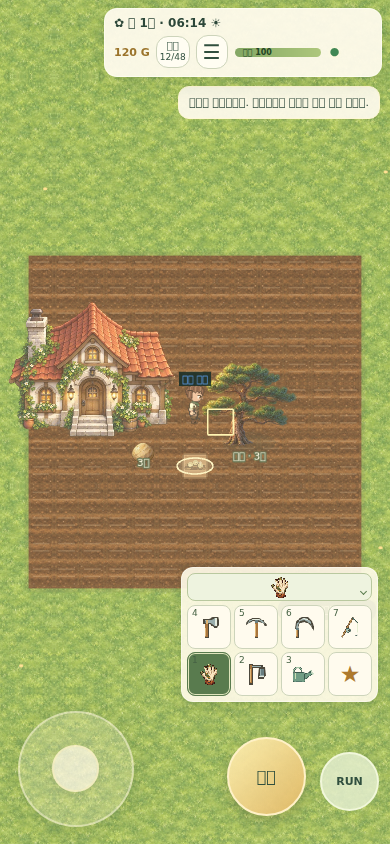
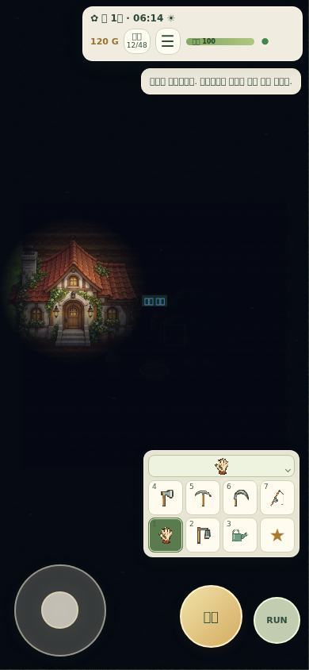
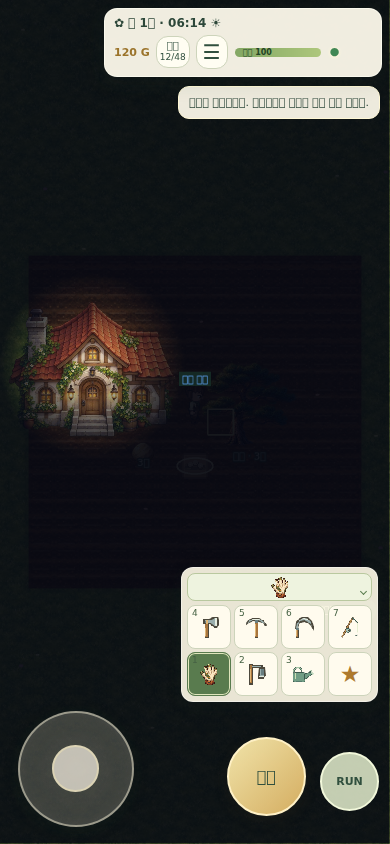

# v2.8.2 — pickup, character editor and lighting

Base: `1cbebebe9dcc3b824b4b37608b1df39851d74bf6` on `feature/v2.7-world-editor-2`.

## Player-facing changes

- Automatic attraction reaches 56px (previously 32px); manual reach is 40px. The server scans every 33ms instead of 120ms, waits 25ms after acquiring a target, and protects newly presented drops for 240ms instead of 800ms. Tool impact/felling presentation still precedes the drop. Committed attraction uses 520px/s and 90–450ms bounded ease-out flight (normally about 90–150ms nearby, previously 300ms).
- `ItemDefinition.itemPickupProfile` controls pickup/magnet radius, approach delay, spawn protection, flight speed, priority and normal/rare feedback. `PickupEffect` exposes bounded radius/speed bonuses for future server-owned equipment or helpers. No client-provided bonus is accepted. The server query, authority check and client effect share the resolver; the durable receipt/lease transaction remains authoritative.
- Face magnifier canvas, crop helper, event and CSS were removed. Native details groups cover basic information, hair, face and clothes; collapsed groups summarize current selections. Full-body direction/motion preview, height reference and sticky save/cancel/reset remain.
- The female preset uses warm brown tied hair, round eyes/brows, a small nose, a terracotta vest, cream sleeves, forest trousers and brown boots. Explicit gender selection replaces only unchanged preset fields. Reset restores the selected gender's preset. Existing customized saves are not migrated or overwritten.
- Ten eye styles now share aperture clipping and independently tunable left/right/side iris offsets, pupil width and eyebrow spacing. Highlights share a screen light direction. Head layers still follow all authored walking/tool/carry anchors.
- Outdoor daylight uses a warm screen blend: spring 12%, summer 22%, autumn 14%, winter 8.5% peak with distinct seasonal colors and stronger ground shadows. Existing sunrise/sunset/orbit/calendar remain intact.
- Moonless night ambient is 1.8%; near full moon it reaches at most 7.3%. House/store/shed porch lights and existing rustic lamps create local soft pools in one half-resolution veil with at most 24 visible sources. UI and player names remain readable; indoor/mine light behavior is preserved.

## Validation before push

- Typecheck; server/client production build; 93 unit tests; 27 integration tests; 6 deployment tests: passed.
- Five customization browser tests: mobile/desktop layouts, toggles, save/cancel/reset, female preset, all face/ear/shoe options, all directions/tool grips, peer sync and cross-device reconnect: passed.
- Real touch/joystick felling, drop collection and tools; PC/touch watering tests: passed.
- Scene lighting/growth test: passed, including seasonal/day/night screenshots, camera direction invariance, seed light and bounded texture count.
- Screenshot comparisons below are local Chromium scene probes; in-game HUD clock is left unchanged by the presentation-only probe. This runtime lacks Korean fonts; CI installs Noto CJK for its screenshot artifacts.
- Full repository CI, PostgreSQL tests, remaining browser gates and both Railway deployment checks run after push. Their final status is reported in the task response.

